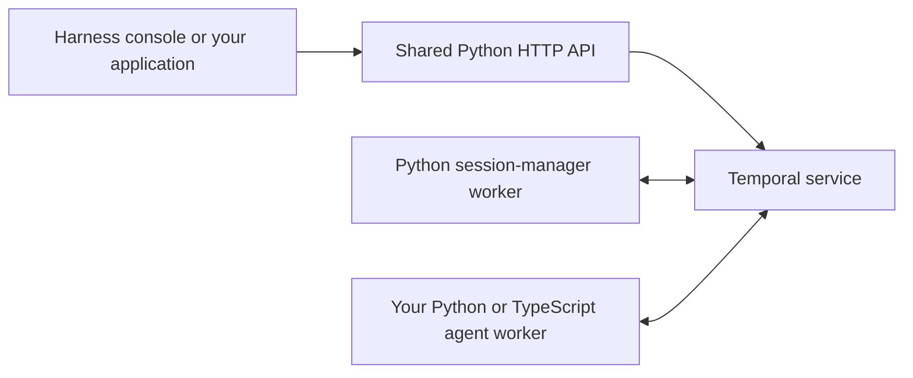

# Temporal Agent Harness

[](https://pypi.org/project/temporal-agent-harness/)
[](https://www.npmjs.com/package/@temporalio/agent-harness)
[](LICENSE)

**Build durable, composable AI agents on Temporal using Python or TypeScript and the AI SDKs you already use.**

> **Experimental.** APIs change between releases. Pin versions and upgrade deliberately.

[Demo video](https://www.youtube.com/watch?v=z3L41NvF6wE) ·
[Releases](https://github.com/temporal-community/temporal-agent-harness/releases)

An agent is a Temporal workflow. The harness gives it typed messages, tools, streaming, and
human interaction so you can focus on the agent's behavior.

- **Durable execution:** recover workflow state after worker restarts; retry model and activity calls by policy.
- **Human approval:** pause tool calls for decisions and resume when they arrive.
- **Composition:** connect agents through typed inputs, outputs, and observable state.
- **Code Mode:** let the model orchestrate tools and subagents with sandboxed code.
- **Product interfaces:** inspect runs in the console or build a typed React/Svelte application.

## Installation

| Start here | What you'll build |
| --- | --- |
| [Python quickstart](python/README.md) | A Python agent and worker, with the shared console |
| [TypeScript quickstart](typescript/packages/core/README.md) | A TypeScript agent and worker, with the same console |
| [Example agents](docs/guides/examples.md) | Run existing agents from a release checkout |
| [Build with a coding agent](#coding-agent-setup) | Install the SDK's versioned skill and starter |

### Build with it — install from PyPI

In your own Python project:

```bash
uv add 'temporal-agent-harness[ui]==0.8.0'
```

Follow the [Python guide](python/README.md#build-with-it--install-from-pypi) for model integration
extras, a complete agent, worker registration, and startup commands. No repository checkout is required.

### Build with it — install from npm

In your own Node.js project:

```bash
npm install --save-exact @temporalio/agent-harness@0.2.0 @temporalio/agent-harness-worker@0.2.0
```

Follow the [TypeScript guide](typescript/packages/core/README.md#build-with-it--install-from-npm)
for the complete compatible dependency set, TypeScript configuration, and first working session.

### How the pieces run



**The shared API, UI server, and session manager currently come from the Python package.**
TypeScript users can run them with `uvx` without creating a Python project. The npm SDK runs
TypeScript agents; it does not yet include a Node.js harness server.

The harness console is at **localhost:8000**. Temporal's own workflow UI is at **localhost:8233**
when using the local dev server. Both quickstarts explain which processes to start.

## Coding-agent setup

These commands ship with the next SDK releases; they are not in Python 0.8.0 / npm 0.2.0.

Each SDK ships a skill, focused references, and an OpenAI starter matching that SDK release.
After installing the SDK, explicitly install its skill in your application project:

```bash
# Python
uv run temporal-agent-harness skills install

# TypeScript
npx agent-harness skills install
```

Then ask your coding agent to use `temporal-harness-python` or `temporal-harness-typescript`.
The skills live in `.agents/skills/`; other tools can install from the directory printed by
`skills path`. Package installation alone does not activate a skill.

Use `temporal-agent-harness init ./my-agent` or `npx agent-harness init ./my-agent` to copy a
starter. The commands create files without overwriting existing ones. Follow the generated
README to install dependencies, configure credentials, and start the application.

After upgrading an SDK, rerun `skills install` to update unchanged skill files. Local edits
produce a conflict instead of being overwritten. See [coding-agent development](docs/agent-development.md).

## Documentation

| Topic | Guide |
| --- | --- |
| API, sessions, streaming, reconnects | [Harness API](docs/api/README.md) |
| Tools, approvals, state, and composition | [Capabilities](docs/guides/capabilities.md) |
| Handler schemas and mid-turn messages | [Messages](docs/guides/messages.md) |
| Human approval and auto mode | [Approvals](docs/guides/approvals.md) |
| Code Mode, virtual files, and subagents | [Code Mode](docs/guides/code-mode.md) |
| Typed application clients | [React / Svelte](docs/guides/client-ui.md) |
| Embed the API/UI in your service | [Self-hosting](docs/api/hosting.md) |
| Work on this repository | [Contributing](AGENTS.md) and [development](docs/internal/development.md) |
| Publish a release | [Release guide](RELEASE.md) |

## Versioning and stability

The Python and npm SDKs have independent release versions. Keep the npm harness packages at
one harness version and use the underlying Temporal/model SDK versions documented by the
quickstart. Commit your dependency lockfile. Examples live in release checkouts, not in the SDK
packages; the small `init` starters are bundled separately.

Use the [release notes](https://github.com/temporal-community/temporal-agent-harness/releases)
when upgrading. The new skill and starter commands described here will be available with the
next package releases; existing published versions do not gain commands from a README update.

<details>
<summary>Links to moved sections</summary>

The detailed sections now have their own guides. Existing README links remain available below.

<a id="what-you-get"></a>
[what you get](docs/guides/capabilities.md#what-you-get) · <a id="-durable-execution--the-foundation"></a>
[durable execution  the foundation](docs/guides/capabilities.md#-durable-execution--the-foundation) · <a id="-standardized-agents-fully-observable"></a>
[standardized agents fully observable](docs/guides/capabilities.md#-standardized-agents-fully-observable) · <a id="-your-own-ui-typed-end-to-end--react-and-svelte"></a>
[your own ui typed end to end  react and svelte](docs/guides/capabilities.md#-your-own-ui-typed-end-to-end--react-and-svelte) · <a id="-human-in-the-loop-solved"></a>
[human in the loop solved](docs/guides/capabilities.md#-human-in-the-loop-solved) · <a id="-bring-your-own-ai-sdk"></a>
[bring your own ai sdk](docs/guides/capabilities.md#-bring-your-own-ai-sdk) · <a id="-durable-and-inline-tools"></a>
[durable and inline tools](docs/guides/capabilities.md#-durable-and-inline-tools) · <a id="-callback-tools--let-the-client-run-the-tool"></a>
[callback tools  let the client run the tool](docs/guides/capabilities.md#-callback-tools--let-the-client-run-the-tool) · <a id="-agents-that-are-more-than-chatbots"></a>
[agents that are more than chatbots](docs/guides/capabilities.md#-agents-that-are-more-than-chatbots) · <a id="-composable-by-construction"></a>
[composable by construction](docs/guides/capabilities.md#-composable-by-construction) · <a id="-code-mode--give-the-model-code-not-just-a-call-menu"></a>
[code mode  give the model code not just a call menu](docs/guides/capabilities.md#-code-mode--give-the-model-code-not-just-a-call-menu) · <a id="auto-mode--letting-code-or-a-model-decide"></a>
[auto mode  letting code or a model decide](docs/guides/approvals.md#auto-mode--letting-code-or-a-model-decide) · <a id="code-mode"></a>
[code mode](docs/guides/code-mode.md#code-mode) · <a id="okf-bundles"></a>
[okf bundles](docs/guides/code-mode.md#okf-bundles) · <a id="accepted-messages"></a>
[accepted messages](docs/guides/messages.md#accepted-messages) · <a id="discovery"></a>
[discovery](docs/guides/messages.md#discovery) · <a id="build-a-ui-in-react-or-svelte"></a>
[build a ui in react or svelte](docs/guides/client-ui.md#build-a-ui-in-react-or-svelte) · <a id="requirements"></a>
[requirements](docs/guides/examples.md#requirements) · <a id="run-the-examples"></a>
[run the examples](docs/guides/examples.md#run-the-examples) · <a id="one-example-standalone"></a>
[one example standalone](docs/guides/examples.md#one-example-standalone) · <a id="all-examples-behind-one-ui"></a>
[all examples behind one ui](docs/guides/examples.md#all-examples-behind-one-ui) · <a id="self-hosting-the-web-app"></a>
[self hosting the web app](docs/api/hosting.md#self-hosting-the-web-app) · <a id="try-the-example-agents"></a>
[try the example agents](python/README.md#try-the-example-agents) · <a id="run-the-web-ui--no-checkout-no-node"></a>
[run the web ui  no checkout no node](python/README.md#run-the-web-ui--no-checkout-no-node) · <a id="extras"></a>
[extras](python/README.md#extras) · <a id="a-taste"></a>
[a taste](python/README.md#a-taste) · <a id="running-a-worker--one-plugin"></a>
[running a worker  one plugin](python/README.md#running-a-worker--one-plugin)

<a id="closing-idle-agents"></a>
[Closing idle agents](python/README.md#closing-idle-agents)

</details>
