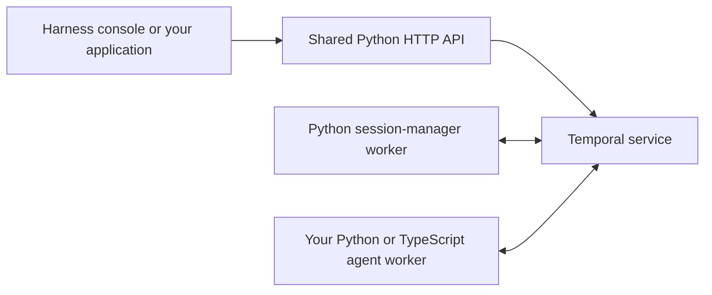

# Temporal Agent Harness

[](https://pypi.org/project/temporal-agent-harness/)
[](https://www.npmjs.com/package/@temporalio/agent-harness)
[](LICENSE)

**Build durable, composable AI agents on Temporal using Python or TypeScript and the AI SDKs you already use.**

> **Experimental.** APIs change between releases. Pin versions and upgrade deliberately.

[Demo video](https://www.youtube.com/watch?v=z3L41NvF6wE) ·
[Releases](https://github.com/temporal-community/temporal-agent-harness/releases)

An agent is a Temporal workflow. The harness gives it typed messages, tools, streaming, and
human interaction so you can focus on the agent's behavior.

- **Durable execution:** recover workflow state after worker restarts; retry model and activity calls by policy.
- **Human approval:** pause tool calls for decisions and resume when they arrive.
- **Composition:** connect agents through typed inputs, outputs, and observable state.
- **Code Mode:** let the model orchestrate tools and subagents with sandboxed code.
- **Product interfaces:** inspect runs in the console or build a typed React/Svelte application.

## An agent in Python and TypeScript

Both SDKs turn a typed message handler into a durable Temporal workflow. These agents use the
OpenAI Agents SDK, stream replies, and keep conversation history across messages and worker
restarts. The worker's harness and model plugins handle the Temporal integration.

### Python

```python
from temporalio import workflow
from temporalio.contrib.workflow_streams import WorkflowStream

with workflow.unsafe.imports_passed_through():
    from agents import Agent, Runner, TResponseInputItem
    from temporal_agent_harness.harness import AgentWorkflowRunner, agent
    from temporal_agent_harness.harness.agent_protocol import AgentConfig, TextMessage, TextReply


@agent.defn
class ChatAgent:
    @agent.init
    def __init__(self, config: AgentConfig) -> None:
        self.runner = AgentWorkflowRunner(config, stream=WorkflowStream())
        self.history: list[TResponseInputItem] = []

    @agent.accepts
    async def ask(self, message: TextMessage) -> TextReply:
        """Chat with the assistant."""
        result = Runner.run_streamed(
            Agent(name="Assistant", instructions="Answer briefly.", model="gpt-5.1"),
            input=[*self.history, {"role": "user", "content": message.text}],
            context=self.runner,
        )
        async for _event in result.stream_events():
            pass
        self.history = result.to_input_list()
        return TextReply(text=str(result.final_output))
```

### TypeScript

```ts
import { Agent, type AgentInputItem } from "@openai/agents-core";
import { defineAgent, handler, TextMessage, TextReply } from "@temporalio/agent-harness";
import { runStreamed } from "@temporalio/agent-harness/ai-sdks/openai-agents-harness";

export const ChatAgent = defineAgent({
  name: "ChatAgent",
  handlers: {
    ask: handler({ description: "Chat with the assistant.", input: TextMessage, output: TextReply }),
  },
  create: ({ runner }) => {
    let history: AgentInputItem[] = [];
    return {
      async ask({ text }) {
        const result = await runStreamed(
          runner,
          new Agent({ name: "Assistant", instructions: "Answer briefly.", model: "gpt-5.1" }),
          [...history, { role: "user", content: text }],
          { defaultModelParams: { startToCloseTimeout: "2 minutes", heartbeatTimeout: "30 seconds" } },
        );
        for await (const _event of result) void _event;
        await result.completed;
        history = result.history;
        return { text: String(result.finalOutput) };
      },
    };
  },
});
```

The quickstarts below provide complete projects with workers, registry configuration, and a
sample weather tool. Add [tools, approvals, and observable state](docs/guides/capabilities.md),
or define your own typed operations beyond chat. See the
[Python](python/README.md#running-a-worker--one-plugin) and
[TypeScript](typescript/packages/core/README.md#running-a-worker--one-harness-plugin) worker setup
to run a custom agent definition.

## Installation

| Start here | What you'll build |
| --- | --- |
| [Python quickstart](python/README.md#quickstart) | A Python agent and worker, with the shared console |
| [TypeScript quickstart](typescript/packages/core/README.md#quickstart) | A TypeScript agent and worker, with the same console |
| [Example agents](docs/guides/examples.md) | Run existing agents from a release checkout |
| [Build with a coding agent](#coding-agent-setup) | Install the SDK's versioned skill and starter |

> The quickstarts' `init`, `skills`, `dev`, and `doctor` commands ship with the next Python and
> npm releases; they are not in Python 0.8.0 / npm 0.2.0. The manual setup below works today.

To add the SDK to an existing project:

```bash
# Python
uv add 'temporal-agent-harness[ui]==0.8.0'

# TypeScript
npm install --save-exact @temporalio/agent-harness@0.2.0 @temporalio/agent-harness-worker@0.2.0
```

The [Python manual setup](python/README.md#build-with-it--install-from-pypi) covers model
integration extras and worker configuration; the
[TypeScript manual setup](typescript/packages/core/README.md#build-with-it--install-from-npm)
covers the complete compatible dependency set. No repository checkout is required for either.

### How the pieces run



**The shared API, UI server, and session manager currently come from the Python package.**
`temporal-agent-harness dev agents.toml` runs the API server and the session manager in one
process, so local development is three processes: Temporal, `dev`, and your agent worker.
TypeScript users run `dev` with `uvx` without creating a Python project. The npm SDK runs
TypeScript agents; it does not yet include a Node.js harness server.

The harness console is at **localhost:8000**. Temporal's own workflow UI is at **localhost:8233**
when using the local dev server. Both quickstarts explain which processes to start.

## Coding-agent setup

Each SDK ships a skill, focused references, and an OpenAI starter matching that SDK release.
After installing the SDK, install its skill where your coding agent discovers project skills:

```bash
# Python
uv run temporal-agent-harness skills install              # Codex: .agents/skills
uv run temporal-agent-harness skills install --for claude # Claude Code: .claude/skills

# TypeScript
npx agent-harness skills install
npx agent-harness skills install --for claude
```

Then ask the agent to use it: `$temporal-harness-python` or `$temporal-harness-typescript` in
Codex, `/temporal-harness-python` or `/temporal-harness-typescript` in Claude Code. Other tools
can install from the directory printed by `skills path`, or with `skills install --dest`.
Package installation alone does not activate a skill.

Use `temporal-agent-harness init ./my-agent` or `npx agent-harness init ./my-agent` to copy a
starter. The commands create files without overwriting existing ones. Follow the generated
README to install dependencies, configure credentials, and start the application.

After upgrading an SDK, rerun `skills install` to update unchanged skill files. Local edits
produce a conflict instead of being overwritten. See [coding-agent development](docs/agent-development.md).

## Documentation

| Topic | Guide |
| --- | --- |
| API, sessions, streaming, reconnects | [Harness API](docs/api/README.md) |
| Tools, approvals, state, and composition | [Capabilities](docs/guides/capabilities.md) |
| Handler schemas and mid-turn messages | [Messages](docs/guides/messages.md) |
| Human approval and auto mode | [Approvals](docs/guides/approvals.md) |
| Code Mode, virtual files, and subagents | [Code Mode](docs/guides/code-mode.md) |
| Typed application clients | [React / Svelte](docs/guides/client-ui.md) |
| Embed the API/UI in your service | [Self-hosting](docs/api/hosting.md) |
| Work on this repository | [Contributing](AGENTS.md) and [development](docs/internal/development.md) |
| Publish a release | [Release guide](RELEASE.md) |

## Versioning and stability

The Python and npm SDKs have independent release versions. Keep the npm harness packages at
one harness version and use the underlying Temporal/model SDK versions documented by the
quickstart. Commit your dependency lockfile. Examples live in release checkouts, not in the SDK
packages; the small `init` starters are bundled separately.

Use the [release notes](https://github.com/temporal-community/temporal-agent-harness/releases)
when upgrading.

<details>
<summary>Links to moved sections</summary>

<a id="what-you-get"></a><a id="-durable-execution--the-foundation"></a><a id="-standardized-agents-fully-observable"></a><a id="-your-own-ui-typed-end-to-end--react-and-svelte"></a><a id="-human-in-the-loop-solved"></a><a id="-bring-your-own-ai-sdk"></a><a id="-durable-and-inline-tools"></a><a id="-callback-tools--let-the-client-run-the-tool"></a><a id="-agents-that-are-more-than-chatbots"></a><a id="-composable-by-construction"></a><a id="-code-mode--give-the-model-code-not-just-a-call-menu"></a><a id="auto-mode--letting-code-or-a-model-decide"></a><a id="code-mode"></a><a id="okf-bundles"></a><a id="accepted-messages"></a><a id="discovery"></a><a id="build-a-ui-in-react-or-svelte"></a><a id="requirements"></a><a id="run-the-examples"></a><a id="one-example-standalone"></a><a id="all-examples-behind-one-ui"></a><a id="self-hosting-the-web-app"></a><a id="try-the-example-agents"></a><a id="run-the-web-ui--no-checkout-no-node"></a><a id="extras"></a><a id="a-taste"></a><a id="running-a-worker--one-plugin"></a><a id="closing-idle-agents"></a>

Former README sections now live in these guides:

- [Capabilities](docs/guides/capabilities.md): what you get, durable execution, standardized
  agents, your own UI, human in the loop, bring your own AI SDK, durable and inline tools,
  callback tools, agents beyond chatbots, composition, and Code Mode.
- [Approvals](docs/guides/approvals.md): auto mode.
- [Code Mode](docs/guides/code-mode.md): Code Mode and OKF bundles.
- [Messages](docs/guides/messages.md): accepted messages and discovery.
- [React / Svelte](docs/guides/client-ui.md): build a UI in React or Svelte.
- [Examples](docs/guides/examples.md): requirements and running the examples, standalone or
  behind one UI.
- [Self-hosting](docs/api/hosting.md): self-hosting the web app.
- [Python guide](python/README.md): the example agents, running the web UI, extras, a taste,
  running a worker, and closing idle agents.

</details>
