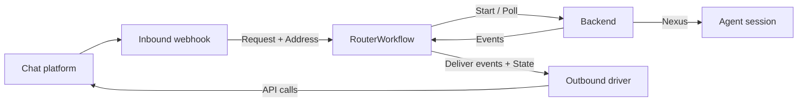

# UI connectors

Slack and Teams use `RouterWorkflow` to send user requests to an agent and deliver
its responses.

## Data flow



The router passes requests and events between adapters. Each backend owns its
handle format. Each platform owns its address and outbound state formats:

1. The inbound webhook starts `RouterWorkflow` with a `protocol.Request` and an
   address that only its own platform reads.
2. The router calls `Backend.Start`, then `Backend.Poll` until the backend is done.
3. The router passes each batch of `protocol.Event` values to `Outbound.Deliver`
   with the state returned by the last call.
4. The router calls `Outbound.Done` at the end.

## Slack use and setup

Mention the bot to chat. Each thread uses its own agent session:
`slack:<channel>:<thread root>`. Replies in a thread that has a bot interaction can
continue the session without another mention.

- `@bot /help` lists the agent's `@agent.accepts` handlers. The Slack guide shows
  each handler's description and possible values for enum and boolean inputs.
- `@bot /set_model model=fast` calls a named handler. Invalid or missing arguments
  return usage instructions.
- Guide buttons open forms from the handler's input fields. A submitted form calls
  the handler in the same thread's session. Field errors keep the form open.
- Guide buttons include a snapshot of the handler's fields when it fits Slack's
  2000-character value limit. The webhook opens these forms directly. Larger forms
  use a workflow to fetch the fields. `/help` refreshes the guide.
- Tool calls and thought summaries appear as task cards. A tool card shows the
  call's arguments, and its error if it failed. A successful result is not shown.
  A status line shows `Thinking…`, or the tools still running; it updates once per
  poll, after the cards.
- Each completed reply shows token usage by model when the backend reports it:
  `gpt-6.1-sol · Input: 2.19M · Cached: 1.99M · Output: 2.56K`.
  Counts include all model calls for that request. Cached tokens are part of input
  tokens. A dash means a count is unavailable. Dollar estimates are not included.
- Approval prompts offer **Approve once**, **Always allow**, and **Deny**.
  Always allow permits future calls to that tool in the session. Backend decision
  events also update prompts when the decision comes from another UI.

The connector posts the guide on the first chat request in a new thread. Set
`SLACK_GUIDE_ON_FIRST_CONTACT=false` to disable this.

To run Slack:

1. Create an app from [the manifest](slack/slack_app_manifest.yaml). Replace
   `YOUR-HOST` with the public webhook host.
2. Run `just slack-webhook` and `just slack-connector` from the repository root.

The webhook reads these environment variables:

| Variable | Purpose or default |
|---|---|
| `SLACK_BOT_TOKEN` | Required bot token |
| `SLACK_SIGNING_SECRET` | Required request signing secret |
| `TEMPORAL_ADDRESS` | `localhost:7233` |
| `CONNECTOR_NAMESPACE` | `connector` |
| `CONNECTOR_TASK_QUEUE` | `nexus-connector-slack` |
| `CONNECTOR_IDENTITY` | Workflow ID prefix; defaults to `default` |
| `WEBHOOK_PORT` | `8080` |
| `ALLOWED_INBOUND_BOT_IDS` | Comma-separated bot IDs; empty accepts no bot messages |
| `SLACK_GUIDE_ON_FIRST_CONTACT` | `false` disables the initial guide |

Use handler commands inside bot mentions. Slack slash command registration is
not required.

## Directory layout

```text
router/              RouterWorkflow and the Backend and Outbound interfaces
protocol/            Requests, events, and handler fields that backends and drivers share
outbound/timeline/   Message timeline for drivers: streams, limits, approvals, status
outbound/markdown/   Markdown rendering and citation markers for drivers
agent/               Backend for the harness Nexus service, and its text commands
slack/               Slack address, inbound webhook, outbound driver, app manifest
slack/interaction/   Action IDs, button payloads, form rendering, and submission decoding
teams/               Teams address, inbound webhook, outbound driver
```


Each platform has `cmd/webhook` and `cmd/worker` programs. The Teams driver calls
the [Python activity worker](teams_activity_worker/README.md).

Platform adapters do not import `agent`, and `agent` does not import a platform.
The `cmd/worker` programs connect the adapters. Keep platform SDKs and backend
payload types out of `router` and the shared `outbound` packages.

Inbound adapters normalize platform input. The backend supplies value types,
constraints, structured results, and errors through `protocol`. Outbound code
formats results and command help. Slack interaction code chooses form controls
and display labels.

## Add a platform driver

Implement `router.Outbound`:

```go
type Outbound interface {
    Deliver(ctx workflow.Context, address Address, state State, events []protocol.Event) (State, error)
    Done(ctx workflow.Context, address Address, state State) error
}
```

`Address` and `State` are JSON. Your inbound webhook writes the address. Your driver
returns the state. The router passes both unchanged. Workflow replay rebuilds state
from workflow code and recorded activity results.

`outbound/timeline` manages messages through a `timeline.Sink` and
`timeline.Config`. The sink makes platform calls; the configuration sets limits:

- A message opens with its first content, so it is never empty.
- An approval request ends the message. The prompt is its own message.
- A message ends at its configured limits, when no tool or thought card is open.
  Drivers can supply `SplitText` to choose text boundaries before sending.
- If an append fails, the content continues in a new message with the open cards.
- If a message cannot open, the rest is posted as complete messages.
- The status updates once per batch.

The timeline code is deterministic. Run it in one of two places:

- In an activity, as Slack does: `Deliver` runs one `SlackDeliver` activity that
  calls `timeline.Apply` and makes the API calls. See
  [the Slack platform](slack/outbound/platform.go).
- In workflow code, as Teams does: the sink calls one activity per platform call.
  See [the Teams driver](teams/outbound/driver.go).

Use `outbound/markdown` to render events as text when your platform has no cards.

To use a different agent, implement `router.Backend`:

```go
type Backend interface {
    Start(ctx workflow.Context, req protocol.Request) (Start, error)
    Poll(ctx workflow.Context, handle Handle) (Poll, error)
}
```

`Handle` is JSON that only the backend reads. `agent.Driver` is the backend for the
harness. It filters events by message ID, so a message that joins an active turn
shows only its own reply.

The inbound webhook builds a `router.Input`. Its `Request` has exactly one field:

- `Message`: chat text. Set `FirstContact` for the initial guide.
- `Call`: a handler name and JSON payload.
- `OpenForm`: a handler name. The address carries the platform's form token.
- `Approval`: a tool approval decision.

Start `router.WorkflowName` with `client.ExecuteWorkflow`. Use
`router.RouterWorkflowID(identity, sessionID, interactionID)` for its ID.
The interaction ID must identify the platform event. See
[the Slack webhook](slack/inbound/server.go).

Register the workflow and activities in `yourplatform/cmd/worker/main.go`:

```go
outbound := yourplatform.NewDriver(...)
backend := &agent.Driver{}
w := worker.New(tc, taskQueue, worker.Options{})
rw := router.NewRouterWorkflow(outbound, backend)
w.RegisterWorkflowWithOptions(rw.Run, workflow.RegisterOptions{Name: router.WorkflowName})
yourplatform.RegisterActivities(w, platform)
```

Run the HTTP server and a Temporal client in `yourplatform/cmd/webhook/main.go`.
Use the same task queue as the worker.

## Platform limits

The Slack connector targets 2,500 characters, including estimated card content.
It finishes the current paragraph, list item, or code block within 1,000 extra
characters. Larger blocks split at a line, sentence, or word. The connector closes
and reopens formatting at these splits. Stream age and card count limits still
apply.

- Slack form trigger tokens expire about 3 seconds after the click. Buttons that
  carry their fields open the modal at once. The fallback workflow must query the
  schema and open the modal inside that window.
- A Slack task card belongs to one message. If that message closes while a tool
  is running, later updates use a new card in the next message. The old card
  remains in progress.
- Slack messages with cards use a Sources list. Text messages use inline citation
  markers. Teams streamed messages omit citations.
- Slack retries failed card content as text. If that succeeds, the worker uses
  text for later cards. A status API error disables status updates in that worker.
- A failed `SlackDeliver` activity is not retried. The router keeps the last saved
  state, and the next delivery continues from it. The Slack calls of the failed
  batch can be lost.
