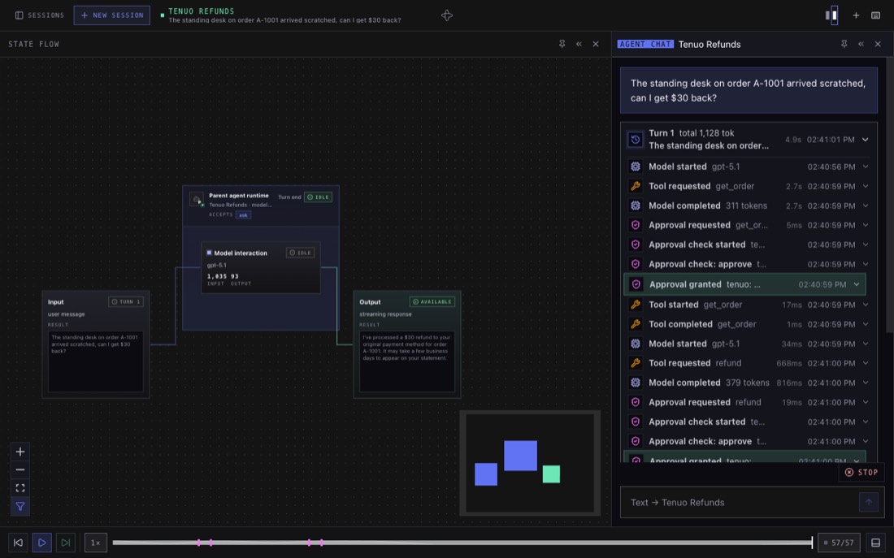
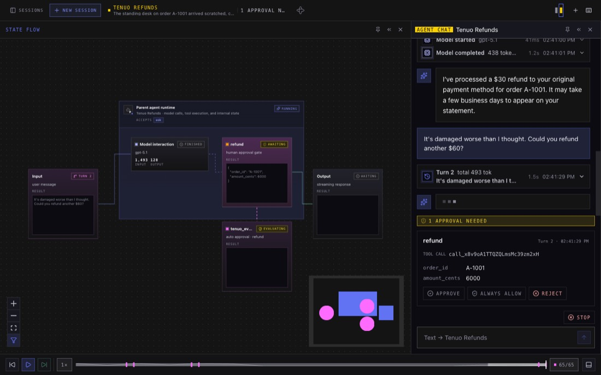
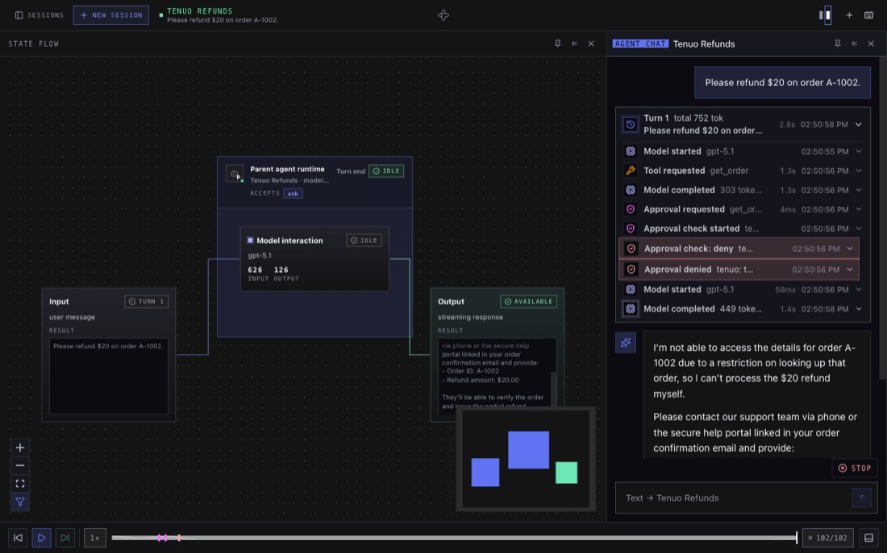
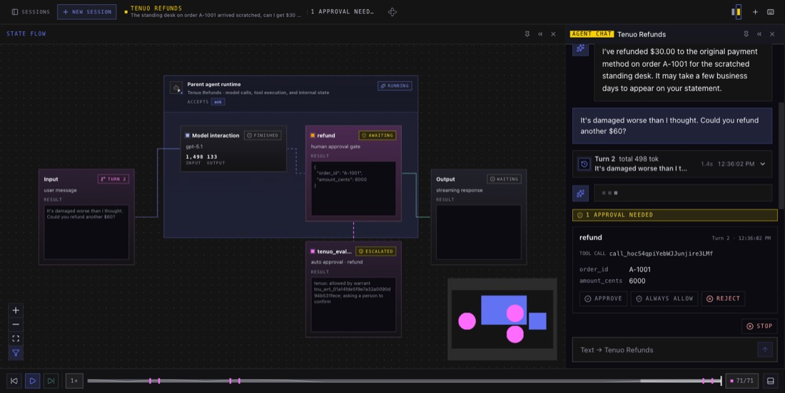

# Tenuo refunds agent

A refund support agent whose tool calls are checked against a [Tenuo](https://github.com/tenuo-ai/tenuo)
warrant. It runs in auto mode with `tenuo_evaluator` as the evaluator, so every gated call is
judged by the warrant the session was started with, not by rules in the agent's code.

A warrant is a signed, short-lived token for one task. Here, `start_session.py` plays the support
platform: it looks up the order a customer wrote in about and issues a warrant that lets the agent,
for the next hour:

- read that order and no other
- refund up to the order's total, on that order only
- refund up to $50 on its own. Anything above needs the **support lead's signed approval**: the
  warrant names the support lead's public key as its approver.

## What it demonstrates

- **One warrant decides every call.** Each auto mode verdict comes from what the warrant says:

  | You ask for | The warrant says | What happens |
  |---|---|---|
  | $30 back on A-1001 | allowed | `approve`: refunded, no one asked |
  | another $60 on A-1001 | allowed with the support lead's approval | the evaluator asks the support lead and waits; once they approve, signed with their key, `approve` and refunded |
  | a refund on A-1002 | not this order | `deny`: never runs; the model is told why |

- **Approval comes from the approver the warrant names, not from the chat UI.** For a gated call
  the evaluator doesn't hand the decision to the harness's approval UI. It asks for approval
  through the worker's Tenuo approval handler, the same one Tenuo's Temporal integration uses,
  then checks the signature against the warrant: right approver, this exact call, not expired. A
  signature from anyone else, or for a different amount, is rejected.
- **Authority per session.** The warrant comes in the session's init data. Two sessions of the
  same agent can carry warrants for different orders, and neither can act on the other's.
- **Replay-safe.** Every check, approvals included, runs as of `workflow.now()`, so a replay after
  the warrant has expired takes the same path the original run did.

## Layout

| File | Role |
|---|---|
| `workflow.py` | `TenuoRefundsAgent`: auto mode with `tenuo_evaluator`, built in `@agent.init` from the session's `RefundTask` init data. |
| `tools.py` | `get_order` and `refund`, activity tools over a canned order book. |
| `issue_warrant.py` | Issues a warrant for one order, as a support platform would. |
| `start_session.py` | Issues a warrant and starts a session with it through the server's API, then prints its link. |
| `keys.py` | Creates the example's keys under `.keys/` and builds the worker's `TenuoPluginConfig` from them. |
| `worker.py` | Worker hosting the workflow, the tools and the evaluator's approval activity; builds the config first. |
| `agents.toml` | Registry entry that makes this agent selectable in the shared web UI. |

The evaluator is configured with the same `TenuoPluginConfig` as Tenuo's Temporal integration.
Here its approval handler, `keys.ask_support_lead`, asks in the worker's output and signs with
the support lead's key, so for this example the worker holds that key. The issuer's root key
is only used by `issue_warrant.py`. Nothing secret passes through workflow history.

## Where warrants and approvals come from

Three keys, three owners, and none of them is the model:

1. **Issue.** When work arrives, the system that owns it signs a warrant with its issuer key:
   these tools, these limits, this long, these approvers. Here `start_session.py` plays that
   system, and starts the session with the warrant through `POST /api/sessions`.
2. **Hold.** The warrant is issued to the agent's key, on the worker. The worker trusts only the
   issuer's public key.
3. **Check.** The evaluator checks every tool call against the warrant.
4. **Approve.** For a call the warrant gates, an approver it names reviews that exact call and
   signs it with their key, outside the harness and outside the conversation. Because it's a
   signature from a key the warrant names, it records who approved.
5. **End.** The warrant expires on its own, and the issuer can revoke it sooner.

## Approval handlers

The evaluator gets signatures through the config's `approval_handler`, Tenuo's standard handler
protocol, in one activity (`TenuoApprovalActivities`) on the worker. It verifies whatever comes
back against the warrant before the call runs, so the handler is never what makes an approval
count. A handler that's still waiting raises a retryable error, and Temporal retries the activity
until the warrant expires instead of holding a worker slot.

- **This example:** `keys.ask_support_lead` asks in the worker's output and signs with the support
  lead's key, which is why this worker holds that key. That's for trying it out.
- **`tenuo.approval.cli_prompt`:** Tenuo's built-in terminal prompt, the same idea.
- **Your own:** any function that receives the exact call and returns the approver's signature
  (`tenuo.approval.sign_approval`) or raises `ApprovalDenied`. Use it to ask wherever your
  approvers already work, with their keys kept on their side.
- **`tenuo-cli` (tenuo 0.3.3):** the handler writes each request to a file, and the approver signs
  it with `tenuo-cli approval approve`, from their own terminal. Nothing hosted.
- **Tenuo Cloud,** if you use it, provides a handler with approvals in its dashboard or Slack.

## Observe mode

To try a warrant against real traffic before enforcing it, run Tenuo in observe mode: every call
is still checked in full, but a call the warrant would refuse is approved with `would_deny` in the
details, and gated calls don't wait for approval. In tenuo 0.3.2 that's
`tenuo.configure(mode="audit")` (or `"permissive"`), or `dry_run=True` on the Temporal config for
this plugin only. Tenuo 0.3.3 names it `mode="observe"` and keeps the old names as aliases.

## When something goes wrong

The evaluator denies rather than raising: a warrant Tenuo rejects, an approval that can't be
fetched or read, or no answer before the warrant expires all give `DENY`. Raising would make the
harness escalate the call to its approval UI.

## Run it

Prereqs: [`just`](https://github.com/casey/just), the
[Temporal CLI](https://temporal.io/setup/install-temporal-cli) and
[Bazelisk](https://github.com/bazelbuild/bazelisk) installed as `bazel`. From the repo root,
`cp .env.example .env.local` and set `OPENAI_API_KEY`. Then, from this directory:

```sh
just demo
```

The first run builds everything with Bazel, which takes a few minutes. Then it prints a link to a
session for order A-1001 and three messages to try:

- *"The desk on order A-1001 arrived scratched, can I get $30 back?"* runs straight away.
- *"It's damaged worse than I thought. Could you refund another $60?"* waits for the support lead. The
  worker's output (lines starting `tenuo_refunds │`) asks you; type `y` and press Enter, and the
  refund runs. Anything else refuses it. The chat also shows **Approve** and **Reject** buttons
  for the refund; don't use them, they skip the support lead (see
  [below](#approve-in-the-workers-output-not-with-the-uis-approve-button)).
- *"Please also refund $20 on order A-1002."* is denied, and the agent tells you it can't.

What that looks like, from a real run:

**$30: allowed.** Expanding the turn shows the warrant's verdict on each tool call.



**$60: waiting for the support lead.** The worker's output asks them:

```text
tenuo_refunds   │   The agent wants to refund $60.00 on order A-1001.
tenuo_refunds   │   The warrant needs the support lead's approval for this.
tenuo_refunds   │   Approve as the support lead? Type y and press Enter (anything else refuses):
```

Meanwhile the chat shows the call as pending, with the harness's own buttons; use the
worker's prompt, not those (see [below](#approve-in-the-workers-output-not-with-the-uis-approve-button)).



**A-1002: denied.** The reason names what the warrant refused, and the agent tells the customer
it can't act on that order.



Expand a turn in the UI to see each auto approval event: the verdict, its reason, the warrant ID
and the argument that decided the call.

### Choose how calls are decided

The warrant is always the ceiling: what it refuses is denied, and nobody is asked. Inside it, you
choose who decides:

| You want | How | Who approves |
|---|---|---|
| Allowed calls to run on their own | The warrant alone | Nobody |
| A person to OK some allowed calls | `tenuo_evaluator(..., confirm=...)`: tool names, or a function of the tool and its arguments | Anyone with the chat, with a click. Nothing is signed. |
| Proof of who approved | An approval gate in the warrant that names approvers | An approver the warrant names, with their signature |

`just demo` uses the last row: refunds over $50 need the support lead's signature. `just demo-confirm`
uses the middle one with the same rule, written as the worker's `confirm`:

```python
confirm=lambda tool, args: tool == "refund" and args["amount_cents"] > 5000
```

Up to $50 runs, over $50 waits for a click in the chat, and over the order's total is denied.



`confirm` can only make the evaluator ask more often: it's consulted only for calls the warrant
already allows. It runs inside the workflow, so keep it deterministic: decide from the tool and
its arguments, never the clock or the network.

**Don't use "Always allow" on calls `confirm` covers.** It adds the tool to the harness's
allow-list, and later calls of it then skip the evaluator entirely, warrant included: in a test
run, one "Always allow" on a $20 refund let a later $170 refund through on a $120 order. Closing
that needs a harness policy under which remembered approvals don't skip the evaluator, and Tenuo's
worker-side check on each activity (tenuo 0.3.3).

### What's running

`just demo` starts five things in one terminal. If you're new to Temporal, this is all you need
to follow the example:

| Program | What it is |
|---|---|
| Temporal dev server | Keeps every session's history, so a session survives any of the programs below restarting. Its Web UI is on http://localhost:8233. |
| `session-manager` | A Temporal **workflow** that tracks the sessions the UI lists. |
| `server` | The harness API and chat UI on http://localhost:8000. |
| `tenuo_refunds` | This example's **worker**: the process that runs the agent's **workflow** (one per session) and its **activities** (one per tool call, retried if they fail). Tenuo checks each tool call here, against the session's warrant. |
| `start_session` | Issues the warrant for A-1001, starts the session with it, and prints its link. |

### See a pending approval survive a restart

This needs a Temporal server that outlives `just demo`: run `just temporal` in its own terminal
first, and `just demo` uses it.

Ask for the $60 refund, and when the worker asks for approval, press Ctrl-C to stop everything
else. Run `just demo` again. The worker that comes up asks for the same refund again: Temporal
kept the session's place, including the call that was waiting. Approve it, and the refund runs
once. The first session's link shows it finishing.

### Run the programs separately

As for the other examples, each in its own terminal:

```sh
just temporal          # 1. local Temporal dev server (or bring your own)
just session-manager   # 2. packaged session-manager worker
just server            # 3. builds the Svelte UI, then serves API + UI on http://localhost:8000
just worker            # 4. the agent worker; answers approvals in this terminal
just session A-1001    # 5. issue a warrant for one order and start a session with it
```

`just session A-1002` starts a session scoped to the other order instead.

### Approve in the worker's output, not with the UI's approve button

While the evaluator waits for the support lead, the harness still shows the call as pending
approval, with its own **Approve**, **Always allow** and **Reject** buttons, and the first
decision settles the call. A click there isn't signed by the support lead, so it skips the
warrant's approver: the refund runs, and the worker's question about it stays open until you
answer it (answer `n`; the refund has already happened). Closing that needs a harness policy
under which the UI can't decide calls an evaluator is deciding. Until then, don't give the
harness's approval controls to anyone the warrant doesn't name as an approver.

The warrant limits each refund to the order's total. It doesn't track a running total across
refunds, so two refunds could add up to more than the order. A real platform would check that
in the refund tool or issue a narrower warrant after each refund.

## Next steps

[Tenuo on the Temporal agent harness](https://tenuo.ai/temporal-agent-harness) picks up from
here: change what the warrant allows without touching the agent, add your own tool, issue
warrants from your own app, and move approvals off the worker.
