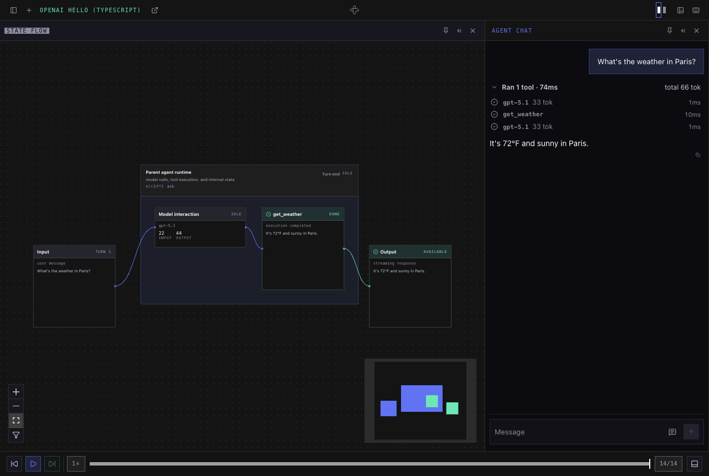

# Hello-world OpenAI Agents agent (TypeScript)

The TypeScript twin of [`python/examples/openai_hello`](../../../python/examples/openai_hello):
the smallest interesting agent you can build on the harness with the **OpenAI Agents SDK**
(`@openai/agents-core`). It chats in plain text and can call one tool (`get_weather`). It's here to
show the harness **streaming** path for the OpenAI integration end to end — from the model call,
through the streaming activity, to the live turn stream the web UI consumes.

Its workflow type (`OpenAIHelloAgentTs`), registry key (`openai-hello-ts`) and task queue
(`openai-hello-ts`) differ from the Python example's, so the two can be served side by side.

## Start here

To build an agent in your own project with published npm packages, follow the
[TypeScript quickstart](../../packages/core/README.md). This directory is the runnable checkout
example; Bazel supplies its toolchains and dependencies.

[Run this example](#run-it) → [Try a conversation](#your-first-session) →
[Modify the agent](#modify-the-agent).

## What it demonstrates

- **Streaming, not blocking.** The turn runs `runStreamed(runner, agent, input)` from
  `@temporalio/agent-harness/ai-sdks/openai-agents-harness`, which runs the agent on the
  `TemporalOpenAIRunner` with streaming on and routes every model call's events to the current
  turn. It's the streamed model activity that feeds each raw OpenAI event to the harness observer.
- **The observer seam.** The worker registers the harness's plugin:
  ```ts
  import { OpenAIAgentsPlugin } from "@temporalio/agent-harness-worker/ai-sdks/openai-agents";

  const worker = await Worker.create({
    connection,
    taskQueue,
    workflowsPath,
    plugins: [new OpenAIAgentsPlugin(), new AgentHarnessPlugin()],
  });
  ```
  Its streamed model activity builds the harness observer for each call, which translates raw
  OpenAI events into harness vocabulary — `model_interaction_started` → `reply_delta` …
  `tool_requested` … `model_interaction_ended`. There are **no run hooks**: the
  model-interaction bracket comes from the observer.
- **Harness-owned tools.** `get_weather` is a normal harness `tool(...)`, adapted onto the SDK with
  `asOpenAIAgentTool(runner, getWeather)`, so the harness keeps approval + `tool_start`/`tool_end`.

## Layout

| File | Role |
|---|---|
| `agents.ts` | `OpenAIHelloAgentTs` — the harness agent; one `ask` handler, one `get_weather` tool, driven by `runStreamed`. |
| `worker.ts` | A plain Temporal worker hosting the agent, with the OpenAI plugin and then `AgentHarnessPlugin` for the harness's own converter and activities. |
| `agents.toml`, `OpenAIHelloAgentTs.schema.json` | Registry entry that makes this agent selectable in the shared web UI, and the agent's schema it points at; generated from `BUILD.bazel` (`bazel run :registry_update`). |
| `agents.test.ts` | The agent on a dev server against a scripted model (no network): a weather question gets a `get_weather` call and a streamed reply. |

There is **no per-example client**: this agent is driven by the shared example stack — the packaged
`SessionManagerWorkflow` worker plus the FastAPI app and web UI (`temporal-agent-harness serve`),
which send messages and stream turns through the harness's built-in `AgentClient`. Both come from
the Python package; only the agent and its worker are TypeScript.

## Run it

Prerequisites: [just](https://just.systems/), [Bazelisk](https://github.com/bazelbuild/bazelisk)
installed as `bazel`, and the [Temporal CLI](https://docs.temporal.io/cli). Start from the release
checkout described in the [quickstart](../../packages/core/README.md#try-the-example-agent).
From the repo root, copy `.env.example` to `.env.local` only if that file is absent, then set
`OPENAI_API_KEY` (and your Temporal connection profile). The recipes load this root file.

From `typescript/examples/openai_hello/`, run each command in its own terminal:

```sh
just temporal          # 1. local Temporal dev server (or bring your own)
just session-manager   # 2. packaged session-manager worker
just server            # 3. builds the Svelte UI, then serves API + UI on http://localhost:8000
just worker            # 4. the agent worker
```

(If the UI build reports missing modules, run `just app-install` once. For UI hot-reloading,
`just ui-dev` runs it on Vite with `/api` proxied to the server on :8000.)

Follow [Your first session](#your-first-session) below. The harness console is on **8000**;
Temporal's workflow UI is a separate application on **8233**.

Without `just`, the equivalent commands (from the repo root, with `.env.local`'s variables
exported):

```sh
bazel run //python/temporal_agent_harness/web:cli -- session-manager
bazel run //python/temporal_agent_harness/web:cli -- serve "$PWD/typescript/examples/openai_hello/agents.toml" --host 0.0.0.0 --port 8000
bazel run //typescript/examples/openai_hello:worker
```

The test runs with `bazel test //typescript/examples/openai_hello/...`.

## Your first session

1. Open <http://localhost:8000>, click **New session** (**+**), choose
   **OpenAI Hello (TypeScript)**, and click **Start session**.
2. Send **“What's the weather in Paris?”** to `ask`.
3. Watch the streamed reply and expand **Ran 1 tool** to inspect `get_weather` with
   `{ "city": "Paris" }`. Its output
   is “It's 72°F and sunny in Paris.” — **sample data**, not a live forecast. Model wording varies.
4. Ask a follow-up, then reload the page to reconnect to the conversation.



This capture uses a scripted model response with a real agent, tool execution, Temporal workflows,
and console. The normal example uses OpenAI. See
[troubleshooting](../../packages/core/README.md#troubleshooting) if the session does not progress.

## Modify the agent

- Change the instructions or tool in `agents.ts`, restart `just worker`, and start a new session.
- For the approval flow, change the example's `dangerouslySkipAll()` policy to
  `alwaysRequireHumanApproval()` and ask about the weather in a new session.
- After changing handler, state, or init schemas, run
  `bazel run //typescript/examples/openai_hello:registry_update` from the repository root.
  This updates the generated schema and registry; review and commit the generated files.
- For agent labels, descriptions, or queues, edit the `harness_ts_agent` declaration in
  `BUILD.bazel` and run the same generator. Keep the worker's queue aligned with the registry.
  The session manager caches its registry; see the quickstart's local-reset guidance before
  replacing a running development registry.

For typed init data, state, Code Mode, subagents, and React/Svelte clients, continue with
[the TypeScript guide](../../packages/core/README.md#what-next).
