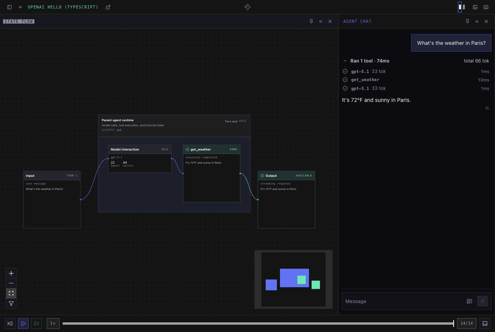

# Temporal Agent Harness for TypeScript

**Temporal-native agent harness (experimental) — build durable, composable AI agents on Temporal,
with the AI SDKs you already use.**

Your agents survive worker restarts, expose typed message handlers, stream model and tool events,
and pause for human approval. Compose them as subagents, give them Code Mode tools, and build
products over their live state with the React and Svelte clients.

> **Experimental.** APIs change between releases. Pin versions and upgrade deliberately.

[Python getting started](https://github.com/temporal-community/temporal-agent-harness#installation)
· [Examples](https://github.com/temporal-community/temporal-agent-harness/tree/main/typescript/examples)
· [Releases](https://github.com/temporal-community/temporal-agent-harness/releases)

<a id="coding-agent-setup-and-starter"></a>

## Quickstart

Create an agent, install its coding-agent skill, and open a working session in four steps.
No repository checkout or Bazel installation is needed.

> **Available with the next npm release.** The starter and skill commands are not in the
> published 0.2.0 package. Once the new release is published, the `@latest` command below selects
> it. Until then, use the [manual setup](#build-with-it--install-from-npm) with published packages.

You need **Node.js 22.18+**, npm, [uv](https://docs.astral.sh/uv/getting-started/installation/),
the [Temporal CLI](https://docs.temporal.io/cli), and an OpenAI API key for the starter.
`uvx` can provision Python for the shared server, which requires Python 3.11+.

### 1. Create the project

Run this from the directory where you want the new project:

```bash
npm exec --yes \
  --package=@temporalio/agent-harness-worker@latest \
  -- agent-harness init my-agent
cd my-agent
npm install
```

`npm exec` supplies the CLI before you have a project. `init` creates a new directory containing
`agents.ts`, `worker.ts`, `agents.toml`, TypeScript configuration, and a README. It pins the
installed harness version and compatible Temporal/model dependencies in `package.json` and
refuses to overwrite existing files. The starter's weather tool returns sample data.

### 2. Configure it and install the skill

```bash
cp env.example .env.local
# Set OPENAI_API_KEY in .env.local; never commit the key.
npm run schema
npm run skill
```

`schema` compiles the agent and writes `agent.schema.json`. `skill` copies this SDK release's
skill into `.agents/skills/temporal-harness-typescript/`, with authoring, API, advanced-feature,
and verification references. Installing the npm package bundles the skill; this explicit step
makes it discoverable in your project.

Open the project in your coding agent. Reload its session if it was already running, then ask:

> Use $temporal-harness-typescript to help me build this agent. Explain the starter, then verify
> it with ping before making model calls.

For tools that use a different skill directory, run `npx agent-harness skills path` to locate
the bundled resources, or use `npx agent-harness skills install --dest <directory>`.

### 3. Start the four services

Run each command in its own terminal, all from this project directory:

**Terminal 1 — Temporal service** (skip if your configured Temporal service is already running):

```bash
temporal server start-dev
```

**Terminal 2 — shared session-manager worker:**

```bash
uvx --from 'temporal-agent-harness[ui]==0.8.0' temporal-agent-harness session-manager
```

**Terminal 3 — shared API and harness console:**

```bash
uvx --from 'temporal-agent-harness[ui]==0.8.0' temporal-agent-harness serve agents.toml
```

**Terminal 4 — your TypeScript agent worker:**

```bash
npm start
```

**The API, console, and session manager come from the Python package.** `uvx` runs those services
without a Python project of your own; your agent worker runs in Node. The console is prebuilt,
so no frontend build is needed.

Defaults are `localhost:7233` and namespace `default`. For another Temporal service, export the
same `TEMPORAL_*` connection settings in each service terminal. `.env.local` loads only into the
Node worker. Leave `TASK_QUEUE_PREFIX` unset for this starter. Keep all four processes running.

### 4. Verify and develop

1. Open the **harness console at <http://localhost:8000>**. Create a session for
   **OpenAI Hello (TypeScript)**.
2. Send `ping` a text message. Expect the same text back without a model request.
3. Send `ask` **“What's the weather in Paris?”**. Expect a streamed reply and a completed
   `get_weather` tool trace with sample weather data. This step calls OpenAI and needs a valid key.
4. Reload the page and confirm the session reconnects.
5. Check startup and worker availability:

   ```bash
   npm run doctor
   ```

Temporal's own workflow UI is at <http://localhost:8233>; it is separate from the harness console.
The worker checks for an API-key environment value at startup, including when testing `ping`.

Edit `agents.ts` to change your agent and `worker.ts` for worker configuration. After changes,
stop the worker, run `npm run schema`, and restart `npm start`. Use a new session for changed
workflow behavior. Commit `agent.schema.json` and `package-lock.json`.

After upgrading the SDK, rerun `npm run skill` to update unchanged skill files. Local edits
produce a conflict and are preserved. Application-client guidance is in the installed skill's
`references/api.md`.

See [coding-agent development](https://github.com/temporal-community/temporal-agent-harness/blob/main/docs/agent-development.md)
for skill discovery and updates, and [troubleshooting](#troubleshooting) if a service fails.

<a id="installation"></a>

## Installation and manual reference

For a new application, start with the [four-step quickstart](#quickstart) above.
The reference below covers existing projects, manual setup, and repository examples.

| I want to… | Do this |
| --- | --- |
| **See it work** — chat with a TypeScript agent in a browser | [Try the example agent](#try-the-example-agent) from a release checkout |
| **Create a new agent project** with a coding-agent skill | [Four-step quickstart](#quickstart) |
| **Add the SDK to an existing project** or assemble it manually | [Install from npm](#build-with-it--install-from-npm) |

Your agent and worker are TypeScript. The shared console and session manager currently come
from the Python package, which `uvx` runs without a Python project of your own. Both SDKs use
the same console, registry format, and session API.

### Which package?

| Package | Use it for |
| --- | --- |
| `@temporalio/agent-harness` | Define agents, handlers, tools, approvals, and state in workflow code |
| `@temporalio/agent-harness-worker` | Run agents: worker plugins, model activities, the server-side agent client, and schema CLI |
| `@temporalio/agent-harness-client` | Build an application client without a UI framework |
| `@temporalio/agent-harness-react` / `@temporalio/agent-harness-svelte` | Build a product UI with live, typed sessions; each re-exports the client |

Model integrations are opt-in imports and optional peer dependencies. The walkthrough below
installs the OpenAI Agents integration. The
[Monty example](https://github.com/temporal-community/temporal-agent-harness/tree/main/typescript/examples/monty)
shows Gemini and Code Mode.

### Try the example agent

You need [just](https://just.systems/), [Bazelisk](https://github.com/bazelbuild/bazelisk) installed
as `bazel`, and the [Temporal CLI](https://docs.temporal.io/cli). Bazel supplies the build
toolchains and dependencies. Examples live in the repository and are not shipped in npm packages.

```bash
git clone --branch npm-v0.2.0 https://github.com/temporal-community/temporal-agent-harness.git
cd temporal-agent-harness
[ -f .env.local ] || cp .env.example .env.local
# Set OPENAI_API_KEY in .env.local.
cd typescript/examples/openai_hello
```

Run each command in its own terminal, from that example directory:

```bash
just temporal          # skip if your configured Temporal server is already running
just session-manager
just server
just worker
```

Open <http://localhost:8000> and follow [Your first session](#your-first-session).
The [example README](https://github.com/temporal-community/temporal-agent-harness/tree/main/typescript/examples/openai_hello#readme)
explains the files and how to modify the agent. The checkout's recipes load the root `.env.local`.

### Build with it — install from npm

You need Node.js **22.18 or later**, npm, an OpenAI API key, the
[Temporal CLI](https://docs.temporal.io/cli), and [uv](https://docs.astral.sh/uv/getting-started/installation/).
`uvx` can provision Python for the shared services; the Python harness requires Python 3.11+.

Create an empty directory:

```bash
mkdir my-agent
cd my-agent
```

Create `package.json`. The install commands below add its dependencies:

```json
{
  "name": "my-agent",
  "private": true,
  "type": "module",
  "scripts": {
    "build": "tsc -p tsconfig.json",
    "schema": "npm run build && agent-harness-schema ./dist/agents.js#OpenAIHelloAgentTs -o OpenAIHelloAgentTs.schema.json",
    "start": "node --env-file=.env.local dist/worker.js"
  }
}
```

Install the harness and the model integration:

```bash
npm install --save-exact @temporalio/agent-harness@0.2.0 @temporalio/agent-harness-worker@0.2.0 @temporalio/agent-harness-client@0.2.0
npm install --save-exact @temporalio/activity@1.24.0 @temporalio/client@1.24.0 @temporalio/common@1.24.0 @temporalio/envconfig@1.24.0 @temporalio/plugin@1.24.0 @temporalio/worker@1.24.0 @temporalio/workflow@1.24.0 @temporalio/workflow-streams@1.24.0 @temporalio/openai-agents@1.24.0
npm install --save-exact @openai/agents-core@0.14.3 @openai/agents-openai@0.14.3 openai@6.46.0 zod@4.6.5
npm install --save-dev --save-exact typescript@7.0.2 @types/node@22.20.4
```

The Temporal SDK packages above share **1.24.0**, matching the OpenAI plugin. The harness packages
have their own version, **0.2.0**. Pinning the Temporal dependencies together avoids installing
incompatible copies through the plugin. Commit `package-lock.json` and use `npm ci` on subsequent
installs. The shared Python services below are pinned separately to **0.8.0**.

Create `tsconfig.json`:

```json
{
  "compilerOptions": {
    "target": "ES2023",
    "module": "NodeNext",
    "moduleResolution": "NodeNext",
    "strict": true,
    "skipLibCheck": true,
    "types": ["node"],
    "rootDir": ".",
    "outDir": "dist"
  },
  "include": ["agents.ts", "worker.ts"]
}
```

Create `.gitignore`:

```gitignore
node_modules/
dist/
.env.local
```

Create `.env.local` with your API key:

```dotenv
OPENAI_API_KEY=your-openai-api-key
```

`npm start` explicitly loads this file. The `uvx` commands below do not load it; they do not need
the OpenAI key. For a non-default Temporal connection, export the same connection settings in
all three service terminals as described under [Temporal connection](#temporal-connection).

### Your first agent

Create `agents.ts`. This agent remembers the conversation across messages, calls one tool, and
streams the reply. The weather tool returns **sample data**, not a live weather forecast.

```ts
import { Agent, type AgentInputItem } from "@openai/agents-core";
import { z } from "zod";
import {
  TextMessage,
  TextReply,
  ToolApprovalPolicy,
  defineAgent,
  handler,
  tool,
} from "@temporalio/agent-harness";
import {
  asOpenAIAgentTool,
  runStreamed,
} from "@temporalio/agent-harness/ai-sdks/openai-agents-harness";

const getWeather = tool({
  name: "get_weather",
  description: "Return sample weather for a city.",
  inputSchema: z.object({ city: z.string() }),
  outputSchema: z.string(),
  inherentlySafe: true,
  execute: async ({ city }) => `It's 72°F and sunny in ${city}.`,
});

export const OpenAIHelloAgentTs = defineAgent({
  name: "OpenAIHelloAgentTs",
  approvalPolicyDefault: ToolApprovalPolicy.allowInherentlySafe(),
  handlers: {
    ask: handler({
      description: "Chat with the assistant. Ask about the weather to try its tool.",
      input: TextMessage,
      output: TextReply,
    }),
  },
  create: ({ runner }) => {
    let conversation: AgentInputItem[] = [];
    return {
      async ask({ text }) {
        const sdkAgent = new Agent({
          name: "Hello",
          instructions: "Answer briefly. For weather questions, call get_weather and explain that it returns sample data.",
          model: "gpt-5.1",
          tools: [asOpenAIAgentTool(runner, getWeather)],
        });
        const input: AgentInputItem[] = [...conversation, { role: "user", content: text }];
        const result = await runStreamed(runner, sdkAgent, input, {
          defaultModelParams: {
            startToCloseTimeout: "2 minutes",
            heartbeatTimeout: "30 seconds",
          },
        });
        for await (const _event of result) void _event;
        await result.completed;
        conversation = result.history;
        return { text: String(result.finalOutput) };
      },
    };
  },
});
```

### Running a worker — one harness plugin

Create `worker.ts`. The model integration's plugin comes first, then `AgentHarnessPlugin`.
The worker bundles the **compiled** `dist/agents.js`; it does not run the agent as ordinary
Node application code.

```ts
import { fileURLToPath } from "node:url";
import { loadClientConnectConfig } from "@temporalio/envconfig";
import { NativeConnection, Worker } from "@temporalio/worker";
import { AgentHarnessPlugin } from "@temporalio/agent-harness-worker";
import { OpenAIAgentsPlugin } from "@temporalio/agent-harness-worker/ai-sdks/openai-agents";

if (!process.env.OPENAI_API_KEY) throw new Error("Set OPENAI_API_KEY in .env.local");

const { connectionOptions, namespace } = loadClientConnectConfig();
const connection = await NativeConnection.connect(connectionOptions);
try {
  const worker = await Worker.create({
    connection,
    namespace: namespace ?? "default",
    taskQueue: "openai-hello-ts",
    workflowsPath: fileURLToPath(new URL("./agents.js", import.meta.url)),
    plugins: [new OpenAIAgentsPlugin(), new AgentHarnessPlugin()],
  });
  await worker.run();
} finally {
  await connection.close();
}
```

The [worker reference](https://github.com/temporal-community/temporal-agent-harness/tree/main/typescript/packages/worker#readme)
covers activity tools, plugins, schema generation, and connection configuration.

### Register the agent

Create `agents.toml` in the project root:

```toml
[[agents]]
key = "openai-hello-ts"
workflow_type = "OpenAIHelloAgentTs"
task_queue = "openai-hello-ts"
label = "OpenAI Hello (TypeScript)"
description = "Chat with a TypeScript agent and try its sample weather tool."
schema = "OpenAIHelloAgentTs.schema.json"
```

Build the project and generate the schema:

```bash
npm run schema
```

The server reads this document without importing your agent code. It describes handlers, state,
and init data; agents with required init data get a form before session creation. Regenerate it
when those declarations change and commit the generated schema with `agents.toml`.

### Run the web UI

Run one command per terminal, all from `my-agent/`:

```bash
# 1. Temporal dev server. Skip if your configured server is already running.
#    Temporal's own workflow UI is at http://localhost:8233.
temporal server start-dev

# 2. Session-manager worker: starts agents and tracks sessions.
uvx --from 'temporal-agent-harness[ui]==0.8.0' temporal-agent-harness session-manager

# 3. Harness console + JSON API: http://localhost:8000.
uvx --from 'temporal-agent-harness[ui]==0.8.0' temporal-agent-harness serve ./agents.toml

# 4. Your TypeScript agent worker; loads .env.local.
npm start
```

The console is prebuilt in the Python package. No frontend build is needed. The console and
session-manager worker are shared infrastructure; your agent code runs on your TypeScript worker.
Leave all four processes running while using the console. After editing TypeScript, stop your
worker, rerun `npm run schema`, and start it again. Start a new session when changing agent behavior.

### Your first session

1. Open the **harness console at <http://localhost:8000>**.
2. Click **New session** (the **+** in the top bar), choose **OpenAI Hello (TypeScript)**,
   then click **Start session**.
3. Send **“What's the weather in Paris?”** to the `ask` handler.
4. Watch the streamed reply, then expand **Ran 1 tool** in the chat to inspect `get_weather`
   and its `{ "city": "Paris" }` input and sample result. The tool returns “It's 72°F and sunny in Paris.”; the model's wording can vary.
5. Ask a follow-up in the same session. Reload the page to reconnect to its recorded conversation.



The screenshot shows the console after a completed weather turn. It uses a scripted model
response for a reproducible capture; the agent, tool execution, Temporal workflows, and console
are real. The quickstart above uses OpenAI and streams its response live.

### Temporal connection

With no connection configured, all three services use `localhost:7233` and namespace `default`.
For a project profile or Temporal Cloud, run these exports in **each** service terminal before
starting the session manager, console, and TypeScript worker:

```bash
export TEMPORAL_CONFIG_FILE="$PWD/temporal.toml"
export TEMPORAL_PROFILE=cloud
```

Use a profile containing your connection details. A `temporal.toml` in the current directory is
not picked up automatically. All services must use the same address and namespace. This
walkthrough uses the literal `openai-hello-ts` task queue in both worker and registry; leave
`TASK_QUEUE_PREFIX` unset. See the worker reference if you need prefixed queues.

## A taste — typed operations and init data

Like Python's `TravelAgent`, an agent can expose a typed operation rather than only text chat.
Zod schemas describe both its messages and the data supplied when the session starts:

```ts
import { z } from "zod";
import { defineAgent, handler, ToolApprovalPolicy } from "@temporalio/agent-harness";

export const TravelAgent = defineAgent({
  name: "TravelAgent",
  approvalPolicyDefault: ToolApprovalPolicy.allowInherentlySafe(),
  initData: {
    schema: z.object({ name: z.string(), home_airport: z.string() }),
    required: true,
  },
  handlers: {
    plan_trip: handler({
      description: "Draft an itinerary for the traveler.",
      input: z.object({ destination: z.string(), nights: z.number().int().positive() }),
      output: z.object({ summary: z.string(), total_usd: z.number() }),
    }),
  },
  create: ({ data }) => ({
    async plan_trip({ destination, nights }) {
      // Replace this sample response with your model and tool calls.
      return {
        summary: `${data.name}: ${nights} nights in ${destination}, departing ${data.home_airport}.`,
        total_usd: 0,
      };
    },
  }),
});
```

This is a separate authoring example, not needed to run Hello. To serve it, export it from your
workflow module, add a matching registry entry, and generate its schema using the worker CLI.

## Troubleshooting

| Symptom | Check |
| --- | --- |
| `OPENAI_API_KEY` is missing, or the model reports an authentication error | Put a valid key in `.env.local` and use `npm start` from the project root. Restart the worker after changing it. |
| Cannot connect to Temporal | Start the dev server, or check `TEMPORAL_CONFIG_FILE`, `TEMPORAL_PROFILE`, and `TEMPORAL_*` overrides in every terminal. |
| Console loads but agent discovery or session creation stalls | Start the session-manager worker and confirm it uses the same Temporal address and namespace as the console. |
| A session starts but messages never progress | Start the TypeScript worker. Its task queue must match `agents.toml`, and its address and namespace must match the other services. |
| `dist/worker.js` or the schema file is missing | Run `npm run schema` from the project root before starting the services. |
| Duplicate protobuf registrations or incompatible Temporal types | Reinstall with the pinned dependency versions above. Keep the underlying Temporal SDK packages aligned with the OpenAI plugin. |
| An edited registry still shows the old agents | The session-manager workflow caches its registry. For disposable local development, restart a fresh in-memory Temporal dev server, then restart the services. This discards local sessions; use it only when you can discard them. |
| Port 8000 shows nothing useful | Open the harness console on 8000; Temporal's workflow UI on 8233 is a separate application. Check the `serve` terminal for startup errors. |

## What next?

- **Approvals:** `allowInherentlySafe()` automatically permits this sample's read-only tool.
  Use `alwaysRequireHumanApproval()` to try the console's approval flow in a new session.
  See [human-in-the-loop approvals](https://github.com/temporal-community/temporal-agent-harness/blob/main/docs/internal/human-in-the-loop-tool-approvals.md)
  for the shared concepts; its code examples are Python.
- **State:** declare observable state with `state(...)` and read or update it through the agent's
  state references. See the
  [Monty trip board](https://github.com/temporal-community/temporal-agent-harness/blob/main/typescript/examples/monty/trip-board.ts)
  and its [agent declaration](https://github.com/temporal-community/temporal-agent-harness/blob/main/typescript/examples/monty/conversational-workflow.ts)
  for a complete example.
- **Code Mode and subagents:** follow the
  [TypeScript Monty example](https://github.com/temporal-community/temporal-agent-harness/tree/main/typescript/examples/monty).
- **Your own product UI:** use the
  [React](https://github.com/temporal-community/temporal-agent-harness/tree/main/typescript/packages/react#readme)
  or [Svelte](https://github.com/temporal-community/temporal-agent-harness/tree/main/typescript/packages/svelte#readme)
  client. These connect to the shared session API for agents written in either language.
- **Worker configuration:** see the
  [worker package](https://github.com/temporal-community/temporal-agent-harness/tree/main/typescript/packages/worker#readme)
  for activity registration and schema CLI details.

## Versioning and stability

Pin the harness packages to the same exact harness release, and pin the underlying Temporal SDK
packages to the version required by your model integration. The Python services have a separate
release version. The manual walkthrough pairs npm **0.2.0** with Python **0.8.0**; do not assume those
version numbers should match.

Examples are not included in the npm packages: use the corresponding `npm-v<version>` repository
tag. Review the [release notes](https://github.com/temporal-community/temporal-agent-harness/releases)
when upgrading, regenerate schemas, and test the worker and shared services together.
